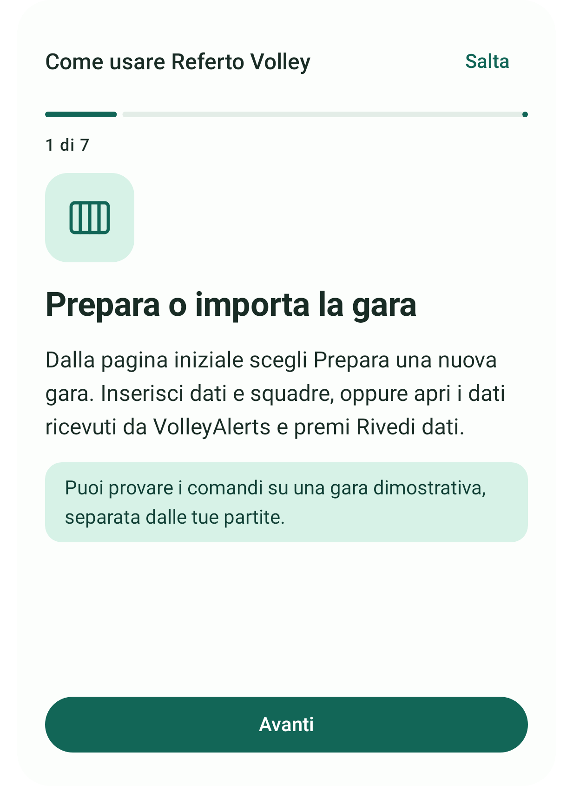

# Tutorial e guida nell’app

Da **0.6.8**, all’apertura senza una revisione della guida già vista appare un overlay in sette passaggi: preparazione/importazione, presenti e staff, sorteggio/formazioni, punti, timeout/cambi/libero, correzioni, ripresa/PDF/backup.

L’overlay ha Avanti, Indietro e Salta; l’ultimo passaggio ha Ho capito. I pulsanti restano fuori dal contenuto scorrevole. Il tutorial non registra eventi, non crea gare dimostrative automaticamente e non modifica la gara aperta. Se l’app viene chiamata da VolleyAlerts, la revisione dei dati ricevuti attende la chiusura della guida.

Si può riaprire dalla voce **Guida** nella pagina iniziale, dal pulsante guida dell’editor e dalla nuova scheda **Guida** durante la gara. La scheda mostra anche tutti i passaggi come consultazione rapida. Il testo dell’overlay e quello della scheda provengono dalla stessa fonte.

## Mantenere la guida aggiornata

La fonte è `app/src/main/java/it/refertoelettronico/ui/AppGuide.kt`:

1. Quando cambia in modo sostanziale un flusso utente, aggiornare `AppGuide.steps` (titolo, descrizione, consiglio e icona).
2. Aggiornare `AppGuide.updatedFor` alla versione che introduce il nuovo contenuto.
3. Incrementare `AppGuide.revision` per riproporre una volta il tutorial anche a chi ha visto la revisione precedente. Non incrementarla per semplici modifiche estetiche o correzioni che non cambiano il flusso.
4. Verificare primo avvio, Avanti/Indietro, Salta/Ho capito, riapertura manuale e mantenimento della gara aperta. Eseguire la suite e aggiornare documentazione/anteprime se necessario.

`GuideProgress` conserva soltanto la revisione vista in preferenze private del dispositivo. Chiudere, saltare o completare segna la revisione corrente come vista. La guida non ricompare a ogni aggiornamento dell’APK: ricompare quando la revisione dei contenuti viene incrementata. Nessun servizio remoto è coinvolto.

## Icona adottata

La 0.6.8 adotta la proposta C6 approvata: sfondo giallo, referto blu e pallone con pannelli blu/gialli/bianchi. L’icona Android è adattiva, con sfondo separato e simbolo trasparente; il margine mantiene il disegno entro la zona centrale sicura. La stessa grafica appare nella testata dell’app.

| Icona Android | Tutorial |
| --- | --- |
|  |  |

Le immagini sono rendering delle risorse e del pannello Android in Robolectric; la prova finale sui launcher del telefono resta necessaria.
