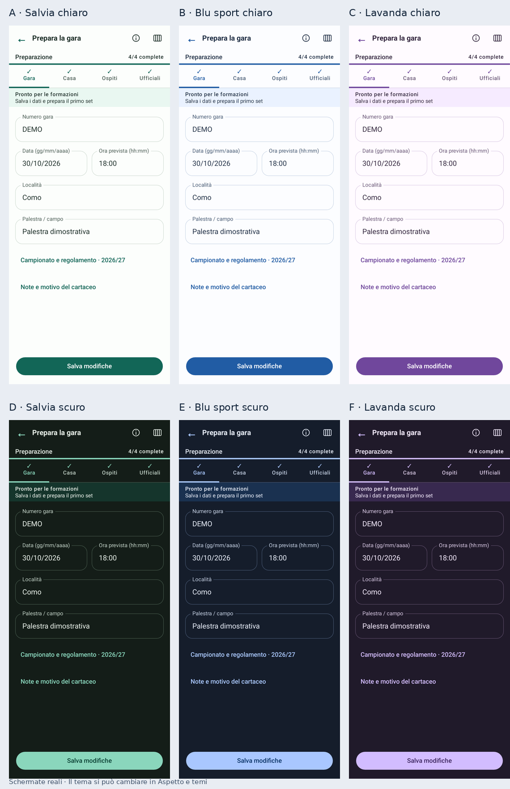

# Aspetto e temi · 0.8.1

Apri **Aspetto e temi** dalla pagina iniziale oppure dalla scheda **Dati** della gara. La scelta si applica immediatamente e viene conservata sul dispositivo.

| Proposta | Palette | Modalità |
| --- | --- | --- |
| [A](ui/tema-A-0.8.1.png) | Salvia | Chiaro |
| [B](ui/tema-B-0.8.1.png) | Blu sport | Chiaro |
| [C](ui/tema-C-0.8.1.png) | Lavanda | Chiaro |
| [D](ui/tema-D-0.8.1.png) | Salvia | Scuro |
| [E](ui/tema-E-0.8.1.png) | Blu sport | Scuro |
| [F](ui/tema-F-0.8.1.png) | Lavanda | Scuro |

Puoi scegliere **Chiaro**, **Scuro** oppure **Come il telefono** per ciascuna palette. L'ultima opzione segue l'impostazione di Android, anche quando cambia mentre l'app è aperta. Per gli aggiornamenti rimane inizialmente selezionato Salvia chiaro, il tema precedente: nessun cambio imposto.

I colori delle squadre restano quelli selezionati per la gara. PDF e area di raccolta della firma mantengono il fondo bianco. Il cambio del tema non modifica gara, cronologia o firme.

Nella preparazione la barra superiore usa i pulsanti Indietro, Guida e Gare; il controllo audio rimane disponibile nelle altre schermate. Le schede Gara, Casa, Ospiti, Ufficiali mostrano separatamente numero o spunta di completamento. I nomi completi delle sezioni sono disponibili al lettore di schermo e nel riepilogo del prossimo passo.
