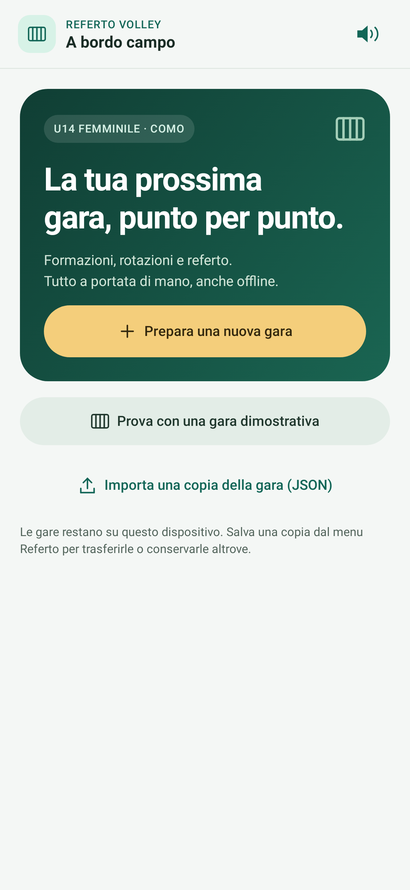
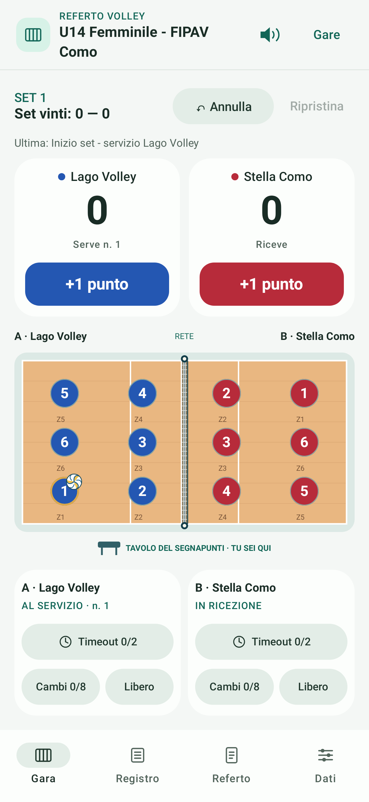
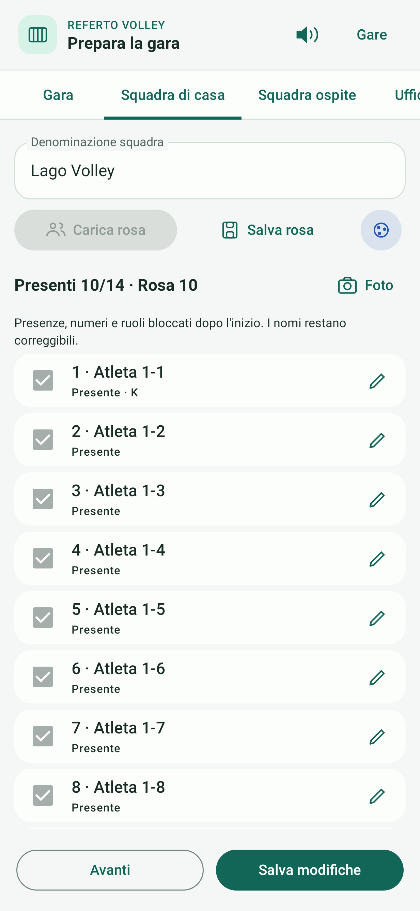

# Interfaccia 0.6.3

Tema Material 3 con palette verde/avorio, accento ambra per la nuova gara, superfici chiare e gerarchia tipografica coerente. I colori assegnati alle squadre restano indipendenti dal tema.

- **Inizio:** azione principale ben distinta, dimostrazione e gare salvate separate.
- **Gara:** punteggi grandi, colore squadra sui pulsanti, indicazione servizio, icone vettoriali nella navigazione. I controlli di ogni squadra occupano due righe: timeout, poi cambi/libero.
- **Distinta:** righe compatte, presenze e icona matita per i dettagli; caricamento, salvataggio, colore e foto hanno comandi distinti.
- **Compilazione:** campi arrotondati e selettori tonali con indicazione di apertura.
- **Foto:** controllo a segmenti per Blocca/Ritaglia/Maglie, con pulsante di lettura sempre accessibile.

Le icone decorative sono accompagnate da testo; matita e colore hanno un nome accessibile. I comandi conservano le aree touch minime Material. Non vengono aggiunti font remoti o dipendenze di rete.

Queste immagini provengono dal rendering delle schermate Compose nei test Android, con dati dimostrativi fittizi.

| Inizio | Gara | Distinta |
| --- | --- | --- |
|  |  |  |

Verifiche: suite esistente di 121 test, build APK e lint Android. Restano da verificare sul telefono tastiera, dimensione caratteri personalizzata e comportamento dei dialoghi di sistema.
