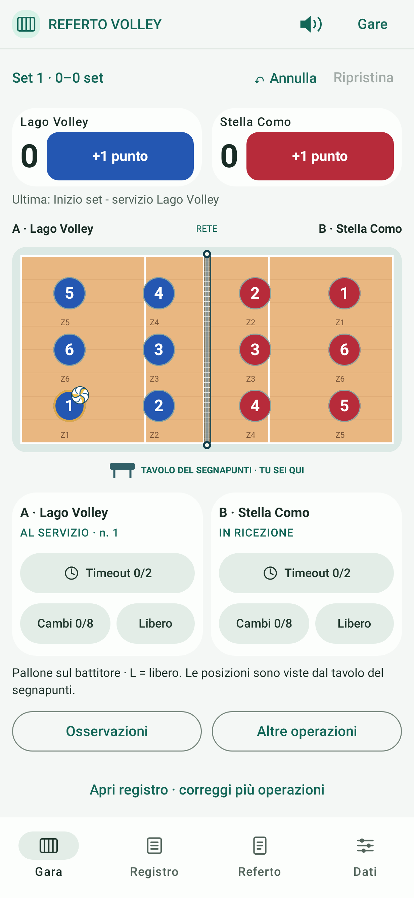
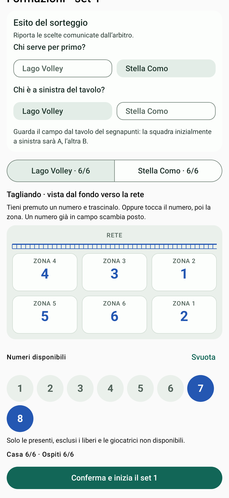
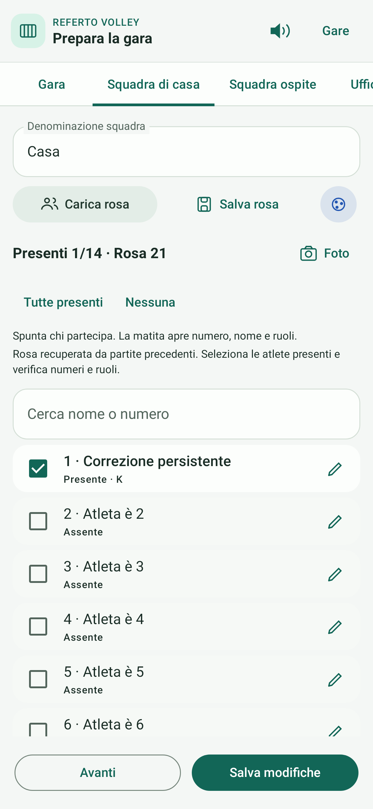
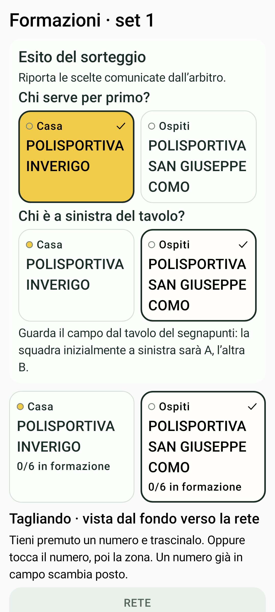
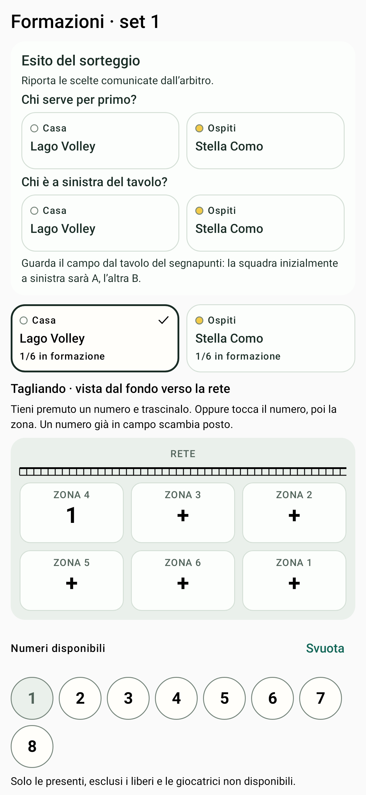
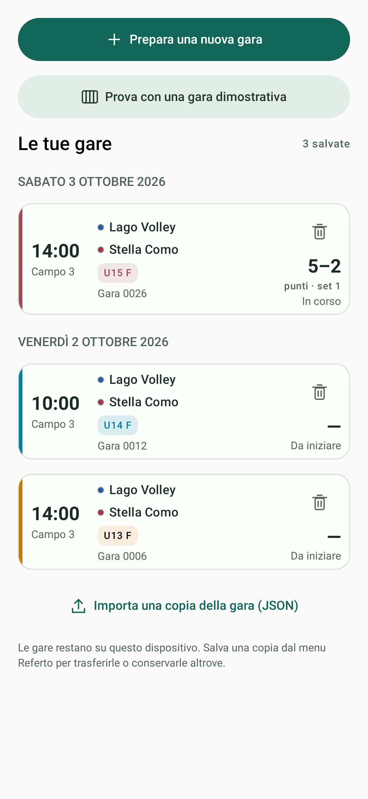

# Interfaccia 0.6.4

Tema Material 3 con palette verde/avorio, accento ambra per la nuova gara, superfici chiare e gerarchia tipografica coerente. I colori assegnati alle squadre restano indipendenti dal tema.

- **Inizio:** azione principale ben distinta, dimostrazione e gare salvate separate. Il cestino elimina una gara dopo la conferma con squadre e data; rose riutilizzabili e JSON esportati restano disponibili.
- **Gara:** barra e punteggi compatti, colori squadra sui pulsanti, icone vettoriali nella navigazione. Ultima azione e avvisi scorrono con il campo. Il test a 411×891 dp verifica oltre il 60% dello schermo disponibile per il contenuto scorrevole. I controlli di ogni squadra occupano due righe: timeout, poi cambi/libero.
- **Distinta:** righe compatte, presenze e icona matita per i dettagli; caricamento, salvataggio, colore e foto hanno comandi distinti.
- **Compilazione:** campi arrotondati e selettori tonali con indicazione di apertura.
- **Foto:** controllo a segmenti per Blocca/Ritaglia/Maglie, con pulsante di lettura sempre accessibile.

Le icone decorative sono accompagnate da testo; matita e colore hanno un nome accessibile. I comandi conservano le aree touch minime Material. Non vengono aggiunti font remoti o dipendenze di rete.

Queste immagini provengono dal rendering delle schermate Compose nei test Android, con dati dimostrativi fittizi.

| Gara compatta | Tagliando formazioni |
| --- | --- |
|  |  |

Il tagliando mostra la rete in alto e le zone **4–3–2 / 5–6–1**, identiche per entrambe le squadre. I numeri si trascinano dopo una pressione prolungata, oppure si assegnano toccando prima il numero e poi la zona. Un numero già assegnato scambia posto; un numero dalla panchina sostituisce quello nella zona. **Svuota** libera tutte le zone. Le zone vuote e le scelte mancanti del sorteggio impediscono l’avvio.

Il sorteggio è all’inizio della preparazione del primo e del quinto set: **Chi serve per primo?** e **Chi è a sinistra del tavolo?**. Il secondo riferimento è sempre la vista del segnapunti. Negli altri set servizio e lati si alternano automaticamente. Le formazioni partono vuote; dopo il primo set è disponibile **Copia formazione del set precedente**, da confrontare con il nuovo tagliando. Durante la gara rimane il campo visto dal tavolo del segnapunti.

Verifiche: suite di 128 test, build APK e lint Android. Restano da verificare sul telefono tastiera, dimensione caratteri personalizzata e comportamento dei dialoghi di sistema.

## Revisione rose e staff 0.6.5

Le candidate cumulative sono tutte inizialmente non presenti. La ricerca per nome/numero restringe la lista senza eliminare o deselezionare le altre voci. I numeri mancanti e i conflitti fra presenti sono evidenziati vicino alle righe. La preparazione può essere ripresa dalla pagina iniziale e mantiene gli identificativi locali, le selezioni e le correzioni.

Lo staff ha sezioni separate per panchina, servizi e ruoli da verificare. La scheda Ufficiali riunisce le proposte per i servizi dell’intera gara; sono richieste selezioni esplicite. Le persone selezionate compilano i campi corrispondenti, da correggere sulla proposta. I codici ricevuti restano conservati anche quando si mappa un incarico manualmente.

## Squadre con nomi simili · 0.6.6

Sorteggio e scelta della formazione mostrano i nomi completi su più righe, con Casa/Ospiti sempre visibili. La squadra selezionata usa come sfondo il proprio colore, con testo a contrasto, spunta e bordo: anche il bianco resta riconoscibile. La scelta non dipende soltanto dal colore o dall’inizio del nome. I conteggi delle formazioni sono separati dal testo del nome e i nomi nel modello dei dati e nel PDF restano invariati.

## Tornare ai dati prima del set · 0.6.7

Sopra il primo tagliando, **Correggi dati e rose** riapre la compilazione della stessa gara. Il tasto Indietro di Android segue lo stesso percorso prima dell’inizio del primo set. Nell’editor, **Salva modifiche** applica le correzioni e torna alle formazioni; **Indietro** permette di tornare senza applicarle, con un messaggio se la bozza è stata modificata. Le modifiche non applicate restano nella bozza e vengono riproposte riaprendo i dati della stessa gara.

Sorteggio e posizioni valide vengono mantenuti durante il passaggio fra formazioni e dati. Se una correzione della rosa rende un numero non disponibile, la relativa zona torna vuota e va completata prima dell’avvio. I vincoli regolamentari dopo l’inizio della gara restano invariati.

## Formazioni chiare e schede iniziali · 0.6.7

Per le squadre bianche e con colori chiari, il tagliando usa numeri e rete scuri, mantenendo il colore della squadra sui numeri trascinabili. I bordi rendono visibili anche i dischi bianchi e la loro anteprima durante il trascinamento.

La pagina iniziale riprende la struttura dei badge dell’esempio: raggruppamento per data, ora/campo a sinistra, nomi separati delle squadre e metadati al centro, risultato/stato e cestino a destra. La fascia laterale e l’etichetta categoria usano un accento coerente. Nessuno stato di validazione esterno è inventato: si mostrano solo Da iniziare, In corso, Tra i set, Interrotta o Terminata secondo la cronologia effettiva. Se esistono gare, l’azione Nuova gara è compatta per lasciare spazio all’elenco.

| Tagliando bianco leggibile | Schede gara |
| --- | --- |
|  |  |
